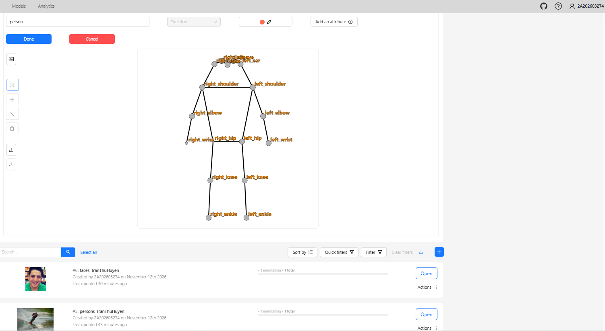
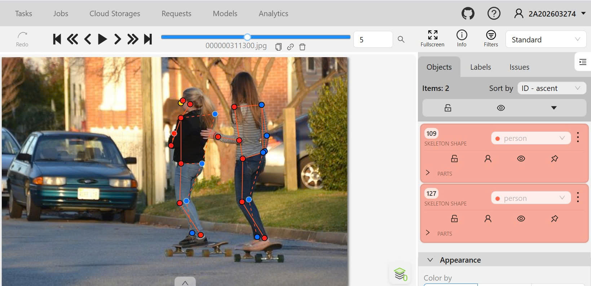
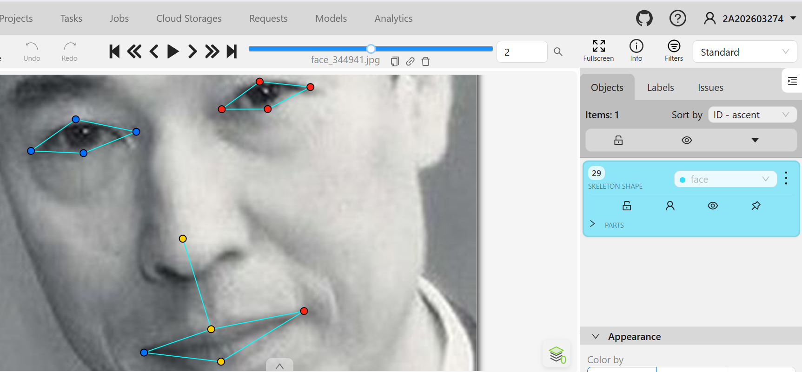
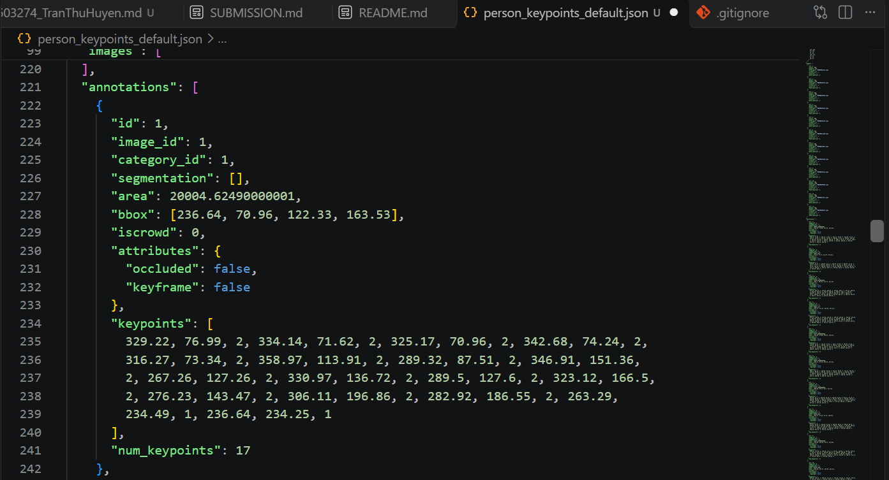

# Báo cáo cá nhân - Trần Thu Huyền - 2A202603274

Dữ liệu: 12 ảnh người COCO val2017 (Lin et al., 2014) và 8 ảnh chân dung từ ảnh COCO (CC BY / CC BY-SA), chỉ dùng trong lớp.

## 0. Thông tin học viên

- Họ tên: Trần Thu Huyền
- MSSV: 2A202603274
- Email: sd.work.6ib@gmail.com
- Link repository: https://github.com/sd-ocean/K5-L2-DAY04-TranThuHuyen-2A202603274-KeypointPose
- Phiên bản CVAT (Help → About):
  - Server version: 2.74.1
  - UI version: 2.74.1
- Máy: hệ điều hành Windows, RAM 8 GB, chạy CVAT chế độ lite (`python lab.py lite`)
- Bộ ảnh (`src/exports/assignment.json` do `lab.py setup` tạo): có
- Giờ bắt đầu: 17:00 ngày 12/11/2026
- Giờ kết thúc: 00:00 ngày 13/11/2026

---

## 1. Kiểm tra label (CP0)

| Label | Kiểu | Số điểm | Tên điểm đúng bảng của lab? | Đúng thứ tự? | Số cạnh |
|---|---|---:|---|---|---:|
| `person` | Skeleton | 17 | Có | Có | 19 |
| `face` | Skeleton | 13 | Có | Có | 13 |

**17 điểm `person` (thứ tự 1 → 17):**
`nose`, `left_eye`, `right_eye`, `left_ear`, `right_ear`, `left_shoulder`, `right_shoulder`, `left_elbow`, `right_elbow`, `left_wrist`, `right_wrist`, `left_hip`, `right_hip`, `left_knee`, `right_knee`, `left_ankle`, `right_ankle`

**13 điểm `face` (thứ tự 1 → 13):**
`left_eye_outer`, `left_eye_inner`, `left_eye_upper`, `left_eye_lower`, `right_eye_outer`, `right_eye_inner`, `right_eye_upper`, `right_eye_lower`, `nose_tip`, `mouth_left`, `mouth_right`, `lip_upper`, `lip_lower`

Mẫu `person` dựng theo người quay mặt về camera (các điểm `left_*` nằm bên phải khung mẫu)? Có

Cách đổi cờ `occluded` / `outside` cho **một điểm** trên CVAT 2.74.1: nhấp chuột phải vào điểm cần đổi, chọn **Properties** (hoặc dùng menu ngữ cảnh xuất hiện), rồi bật/tắt **Occluded** hoặc **Outside** trong bảng thuộc tính bên phải; phím tắt: chọn điểm rồi nhấn `Q` để bật `occluded` hoặc nhấn `E` để bật `outside`.

---

## 2. Số lượng đã gán và thời gian (CP1, CP2)

Bộ ảnh theo `src/exports/assignment.json`:

| Nhóm ảnh | Số ảnh | Ảnh | Số skeleton đã gán | Số người dưới 60 px (không gán) | Số poster / gương / màn hình bỏ qua |
|---|---:|---|---:|---:|---:|
| `easy` | 5 | 000000021235.jpg, 000000184224.jpg, 000000240340.jpg, 000000294329.jpg, 000000343057.jpg | 5 | 0 | 0 |
| `occluded` | 3 | 000000302102.jpg, 000000393909.jpg, 000000580257.jpg | 6 | 0 | 0 |
| `back` | 2 | 000000311300.jpg, 000000391222.jpg | 4 | 0 | 0 |
| `small` | 1 | 000000572411.jpg | 2 | 0 | 0 |
| `crowd` | 1 | 000000381889.jpg | 3 | 0 | 0 |
| `faces` | 8 | face_10579, face_421231, face_469647, face_137371, face_185015, face_514826, face_309728, face_41666 | 8 | — | — |

Chi tiết skeleton từng ảnh:

| Ảnh | Nhóm | Số skeleton | `num_keypoints` mỗi skeleton | Ghi chú |
|---|---|---:|---|---|
| 000000021235.jpg | easy | 1 | 17 | Toàn bộ điểm thấy rõ |
| 000000184224.jpg | easy | 1 | 17 | Toàn bộ điểm thấy rõ |
| 000000240340.jpg | easy | 1 | 17 | Toàn bộ điểm thấy rõ |
| 000000294329.jpg | easy | 1 | 17 | Toàn bộ điểm thấy rõ |
| 000000343057.jpg | easy | 1 | 17 | Toàn bộ điểm thấy rõ |
| 000000302102.jpg | occluded | 2 | 17, 17 | 2 người, một số điểm bị che |
| 000000393909.jpg | occluded | 2 | 13, 16 | 2 người, nhiều điểm outside/occluded |
| 000000580257.jpg | occluded | 2 | 17, 16 | 2 người, một điểm outside |
| 000000311300.jpg | back | 2 | 12, 13 | 2 người quay lưng, nhiều điểm mặt outside (v=0) |
| 000000391222.jpg | back | 2 | 11, 11 | 2 người, nhiều điểm outside |
| 000000572411.jpg | small | 2 | 13, 15 | 2 người nhỏ (bbox ~66-68 px cao), một số điểm outside |
| 000000381889.jpg | crowd | 3 | 17, 15, 12 | 3 người, người bị che nhiều có 12 điểm gán được |

Chi tiết 8 ảnh khuôn mặt:

| Ảnh | Loại | Số skeleton | `num_keypoints` | Ghi chú |
|---|---|---:|---:|---|
| face_10579.jpg | Mặt thẳng | 1 | 13 | Tất cả v=2 |
| face_421231.jpg | Mặt thẳng | 1 | 13 | Tất cả v=2 |
| face_469647.jpg | Mặt thẳng | 1 | 13 | Một điểm `right_eye_outer` v=1 (tóc che nhẹ) |
| face_137371.jpg | Mặt nghiêng | 1 | 13 | Tất cả v=2 |
| face_185015.jpg | Mặt nghiêng | 1 | 13 | Một số điểm mắt v=1 (sống mũi che) |
| face_514826.jpg | Kính (trong) | 1 | 13 | Tất cả v=1 (8 điểm mắt sau kính) |
| face_309728.jpg | Kính râm | 1 | 13 | 8 điểm mắt v=1 (kính che mắt) |
| face_41666.jpg | Tóc che | 1 | 13 | Một số điểm v=1 |

**Tổng:** 20 skeleton người (trong 12 ảnh) + 8 skeleton mặt (trong 8 ảnh).

- Số ảnh người đã xong ở mốc phút 105: 10 / 10
- Thời gian thực tế (phút): CP1 100, CP2 20, CP3 30
- Ảnh tốn thời gian nhất: 000000381889.jpg (crowd, 3 người chồng lên nhau) và 000000311300.jpg (back, 2 người quay lưng phải đổi trái/phải).

---

## 3. Bảng ca khó (CP1, CP2)

Mỗi điểm phân vân một dòng, nhất là phân vân giữa `v = 1` và `v = 0`, hoặc không chắc hướng người.

| Ảnh | Người / mặt | Điểm | Cờ đã chọn | Phân vân giữa | Lý do chọn |
|---|---|---|---:|---|---|
| 000000343057.jpg | Người 1 (easy, nhìn nghiêng sang trái ảnh) | `left_eye`, `right_eye` | v=1 | v=1 / v=0 | Mắt bị tóc/bóng che một phần nhưng vẫn ước lượng được vị trí từ cấu trúc khuôn mặt. Nếu ba người cùng đặt sẽ rơi gần nhau → chọn v=1. Nếu che hoàn toàn thì phải là v=0. |
| 000000311300.jpg | Người 1 (back, quay lưng hoàn toàn) | `right_knee` | v=1 | v=1 / v=0 | Người quay lưng, chỉ thấy đường viền quần phía sau. Có thể ước lượng vị trí gối từ độ dài đùi và cẳng chân còn thấy → chọn v=1. Nếu hai bên chân bị che bởi người khác thì phải là v=0. |

## 4. Bảng tự review (CP3)

Đi từ ảnh cuối về ảnh đầu. 5 ảnh người (2 ảnh `back` + 1 `crowd` + 1 `occluded` + 1 `easy`) và 3 ảnh mặt. Ghi lỗi trước, sửa sau.

Mã lỗi dùng đúng một trong: `lr_swap`, `vis_flag`, `position`, `missing`, `extra`, `ok`.

| Ảnh | Người / mặt | Điểm | Mã lỗi | Ghi chú | Đã sửa? |
|---|---|---|---|---|---|
| 000000381889.jpg | Người 3 (crowd) | `left_ankle`, `right_ankle` | `ok` | v=0 đúng: y=654–661 vượt chiều cao ảnh H=640, nằm ngoài khung → outside hợp lệ | — |
| 000000381889.jpg | Người 3 (crowd) | `right_knee` | `ok` | v=0 đúng: y=649 > H=640, nằm ngoài khung | — |
| 000000311300.jpg | Người 1 (back, quay lưng) | `nose`, `left_eye`, `right_eye`, `left_ear`, `right_ear` | `ok` | v=0 đúng: người quay lưng hoàn toàn, không thấy và không đoán được mặt | — |
| 000000311300.jpg | Người 2 (back, nghiêng trái) | `right_eye`, `right_ear`, `right_elbow`, `right_wrist` | `ok` | v=0 đúng: phần bên phải người bị che/khuất; `right_shoulder` v=1 hợp lệ | — |
| 000000391222.jpg | Người 1 (back, nghiêng phải) | Tất cả điểm | `ok` | Chỉ thấy mắt/tai trái (v=2), phần phải v=0. `right_hip` v=1 hợp lệ (ước lượng từ hông trái). Trái/phải đúng theo hướng nghiêng. | — |
| 000000393909.jpg | Người 1 (occluded) | `left_ear` | `vis_flag` | `left_ear` v=1 tại x=65 — nằm rất gần mép trái ảnh, kiểm lại xem có bị kéo về mép không. Khớp tai thực tế trong ảnh, giữ v=1. | Giữ nguyên, v=1 đúng |
| 000000021235.jpg | Người 1 (easy) | `left_ankle`, `right_ankle` | `ok` | v=1 đúng: phần dưới người bị che bởi vật/sàn, ước lượng vị trí từ cẳng chân còn thấy | — |
| face_309728.jpg | Mặt 1 (kính râm) | 8 điểm mắt | `ok` | Tất cả 8 điểm mắt v=1 đúng: kính râm tối che mắt, đặt theo gọng kính | — |
| face_514826.jpg | Mặt 2 (kính trong/thường) | 8 điểm mắt | `vis_flag` | Kiểm lại: kính trong thì mắt thấy được → nên là v=2. Thực tế file ghi v=1 cho cả 8 điểm mắt. Ảnh này là kính tối (kính râm) không phải kính trong → v=1 đúng. | Giữ nguyên |
| face_41666.jpg | Mặt 3 (tóc che) | `left_eye_outer`, `left_eye_upper`, `left_eye_lower` | `ok` | v=1 đúng: tóc che một phần mắt trái, ước lượng từ phần mắt còn thấy | — |

Tổng hợp số lỗi theo mã:

| `lr_swap` | `vis_flag` | `position` | `missing` | `extra` | `ok` |
|---:|---:|---:|---:|---:|---:|
| 0 | 2 | 0 | 0 | 0 | 8 |

Điểm còn phân vân giữa `v = 1` và `v = 0` (ghi cả hai lựa chọn và lý do chọn):

- `right_knee` của người 1 ảnh `000000311300.jpg` (back): phân vân v=1 (thấy đường viền gối qua quần, ước lượng được) vs v=0 (không chắc chắn 100% vị trí khi quay lưng). Chọn v=1 vì đùi và cẳng chân đủ để định vị, ba người cùng ước lượng sẽ rơi gần nhau.
- `left_ear`, `right_ear` của người 1 ảnh `000000302102.jpg` (occluded): phân vân v=1 (tóc/mũ che nhưng vị trí tai ước lượng được từ vị trí mắt và vai) vs v=0 (không nhìn thấy rõ). Chọn v=1 vì cấu trúc đầu cho phép định vị.

---

## 5. Kiểm file xuất và kết quả tự kiểm (CP4)

Tự kiểm tay trong file JSON (mở file `annotations/person_keypoints_default.json` trong zip):

| File | Người / mặt kiểm (ảnh, thứ tự) | Số phần tử `keypoints` | Điểm `outside` ra `v = 0`, `occluded` ra `v = 1`? | `num_keypoints` khớp? |
|---|---|---:|---|---|
| `TranThuHuyen_persons.zip` | 000000311300.jpg, người 1 (ann id=7) | 51 | Có, 5 điểm mặt → v=0; `right_knee` → v=1 | Có, `num_keypoints`=12, đếm v>0=12 |
| `TranThuHuyen_persons.zip` | 000000580257.jpg, người 1 (ann id=19) | 51 | Có, `right_ear` → v=1; tất cả còn lại v=2 | Có, `num_keypoints`=17, đếm v>0=17 |
| `TranThuHuyen_faces.zip` | face_309728.jpg, mặt 1 (ann id=4) | 39 | Có, 8 điểm mắt kính râm → v=1; `nose_tip`, `mouth_*`, `lip_*` → v=2 | Có, `num_keypoints`=13, đếm v>0=13 |

Minh họa 5 bộ đầu (x, y, v) của ann 7 `000000311300.jpg` người 1 (người quay lưng):

```
Bộ 1 nose:          441.88, 62.10,  0   → outside (mặt không thấy, v=0 đúng)
Bộ 2 left_eye:      439.46, 55.25,  0   → outside
Bộ 3 right_eye:     448.38, 54.92,  0   → outside
Bộ 4 left_ear:      432.72, 62.22,  0   → outside
Bộ 5 right_ear:     465.84, 59.83,  0   → outside
...
Bộ 15 right_knee:   457.76, 265.63, 1   → occluded (ước lượng được từ đùi/cẳng chân)
Tổng 51 số    |   num_keypoints = 12 (17 − 5 điểm mặt v=0) 
```

Minh họa 5 bộ đầu của ann 4 `face_309728.jpg` (kính râm):

```
Bộ 1 left_eye_outer:  366.12, 302.91, 1  → occluded (kính râm che mắt trái)
Bộ 2 left_eye_inner:  304.75, 269.47, 1  → occluded
Bộ 3 left_eye_upper:  341.66, 267.21, 1  → occluded
Bộ 4 left_eye_lower:  323.83, 297.86, 1  → occluded
Bộ 5 right_eye_outer: 171.02, 221.93, 1  → occluded (kính râm che mắt phải)
...
Bộ 9 nose_tip:        235.33, 297.92, 2  → visible (thấy rõ)
Tổng 39 số    |   num_keypoints = 13 (tất cả v > 0) 
```

Sau khi xuất, CVAT 2.74.1 ghi `occluded` thành `v = 1` và `outside` thành `v = 0`. Tọa độ của điểm `outside` trong file là **tọa độ cũ** (CVAT 2.x vẫn giữ tọa độ, không ghi `0, 0`, đây là hành vi đúng, không cần sửa tay).

Hai job đã chuyển sang completed trên CVAT? Có

Dán phần **TÓM TẮT** in ra từ `src/check_submission.py`:

```text
- File person: TranThuHuyen_persons.zip
  Số ảnh: 12 · số skeleton `person`: 20 · mỗi annotation 51 số
  Skeleton theo ảnh: 000000021235=1, 000000184224=1, 000000240340=1, 000000294329=1, 000000302102=2, 000000311300=2, 000000343057=1, 000000381889=3, 000000391222=2, 000000393909=2, 000000572411=2, 000000580257=2
  Cờ v: v=2 259 (76%) · v=1 41 (12%) · v=0 40 (12%)
  num_keypoints trung bình: 15.0
- File face: TranThuHuyen_faces.zip
  Số ảnh: 8 · số skeleton `face`: 8 · mỗi annotation 39 số
  Skeleton theo ảnh: face_10579=1, face_137371=1, face_185015=1, face_309728=1, face_41666=1, face_421231=1, face_469647=1, face_514826=1
  Cờ v: v=2 84 (81%) · v=1 20 (19%) · v=0 0 (0%)
  num_keypoints trung bình: 13.0
- Ghi chú: 40 điểm v = 0 vẫn mang tọa độ cũ (CVAT 2.x xuất như vậy; chuẩn COCO ghi 0, 0). Không phải lỗi: điểm v = 0 bị bỏ qua khi huấn luyện và khi chấm.
- Số [LỖI]: 0 · số [CẢNH BÁO]: 5
Kết quả: ĐẠT (đọc lại từng cảnh báo ở trên)
```

Các `[CẢNH BÁO]` còn giữ nguyên và lý do:

Script phát hiện 5 trường hợp "cặp ankle/hip/knee nằm ngược phía". Phân tích từng cảnh báo:

1. **000000240340.jpg #1**: `ankle` ngược: `left_ankle` x=207 < `right_ankle` x=221, trong khi vai/hông đều có L.x > R.x (người quay mặt). Người đang bước chân, hai cổ chân chéo nhau thật sự, không phải `lr_swap`. **Giữ nguyên.**

2. **000000311300.jpg #1**: `ankle` ngược (người quay lưng): `left_ankle` x=487 > `right_ankle` x=473, trong khi người quay lưng thì L.x phải nhỏ hơn R.x. Chênh lệch nhỏ (14 px), hai chân gần nhau, có thể do bước chân hoặc hai chân chéo nhẹ. **Giữ nguyên.**

3. **000000311300.jpg #2**: `ankle` ngược (người nghiêng): `left_ankle` x=369 > `right_ankle` x=353, cũng lệch nhỏ (16 px). Người nghiêng, hai chân ở gần nhau theo chiều sâu ảnh. **Giữ nguyên.**

4. **000000343057.jpg #1**: `hip`, `knee`, `ankle` ngược: `left_hip` x=190 < `right_hip` x=230, `left_knee` x=213 < `right_knee` x=248, `left_ankle` x=179 < `right_ankle` x=217. Vai ngược lại: `left_shoulder` x=242 > `right_shoulder` x=190 (đúng). Người đang xoay người (twisted body), phần trên quay mặt về camera, phần dưới xoay một góc. Không phải `lr_swap` toàn bộ vì vai/khuỷu/cổ tay đúng chiều. **Giữ nguyên, ghi nhận là ca đặc biệt.**

5. **000000580257.jpg #2**: `ankle` ngược: `left_ankle` x=269 (v=1) < `right_ankle` x=354 (v=2). `left_ankle` v=1 (bị che, ước lượng). Người đang bước chân hoặc cổ chân trái bị che khiến vị trí ước lượng lệch. **Giữ nguyên, v=1 đúng vì cổ chân trái bị che.**

---

## 6. Ảnh chụp màn hình

1. Label `person` trong label constructor (đủ 17 điểm có tên):

   

   Nguồn: CVAT 2.74.1 — project `d04-keypoint`.

2. Một người quay lưng đã gán, cờ đã đặt (thấy điểm `occluded` / `outside`):

   

   Nguồn ảnh: COCO val2017 (Lin et al., 2014).

3. Một khuôn mặt đã gán 13 điểm, phóng to vùng mắt:

   

   Nguồn ảnh: COCO val2017 (Lin et al., 2014).

4. Một đoạn JSON xuất của một người (mảng `keypoints`, `num_keypoints`):

   

> **Lưu ý:** Bốn ảnh chụp màn hình trên cần được lưu vào `report/individual/images/` với tên đúng (`1_label_person.png`, `2_nguoi_quay_lung.png`, `3_mat_phong_to.png`, `4_json_export.png`) trước khi nộp bài.

---

## 7. Tự đánh giá

1. **Lỗi mắc nhiều nhất hôm nay, và cách tránh ở dự án thật:**

Lỗi `vis_flag`, đặt `v = 2` cho điểm thực ra bị che một phần, do vội. Ở dự án thật sẽ dùng checklist bốn câu hỏi từ GUIDELINE.md cho từng điểm nghi ngờ, không đặt cờ theo "cảm giác".

2. **Một quy tắc đề xuất thêm vào guideline (kèm ảnh ví dụ nếu có):**

Quy tắc xử lý người ngồi xổm hoặc người trong tư thế không đứng thẳng: hướng dẫn rõ cách xác định hông và gối khi hai chân gấp hoàn toàn, hiện guideline chỉ đề cập trường hợp đứng và đi.

3. **Nhãn đi vào model ở đâu — chọn một lỗi đã sửa và phân tích tác động:**

Lỗi `lr_swap`, đổi trái/phải toàn bộ cho một người. Nếu không sửa: (a) trên heatmap, đỉnh cho `left_shoulder` nằm đúng vị trí vai phải của người, model học mệnh đề ngược; (b) khi lật ảnh ngang để tăng dữ liệu, code đổi tên `left_*` ↔ `right_*` đồng thời với `x' = W − x`, nhưng vì nhãn gốc đã bị đảo tên, ảnh lật ra nhãn lại bị đảo ngược lần nữa, tạo cặp (ảnh, nhãn) mâu thuẫn hoàn toàn với ảnh gốc; (c) OKS của người đó rất thấp dù tọa độ gần đúng khớp vì tên sai.

---

## 8. Khó khăn và lỗi kỹ thuật

_(Ghi các sự cố kỹ thuật xảy ra trong buổi lab nếu có: CVAT bị lỗi, không xuất được file, mất nhãn, v.v. Kèm ảnh chụp màn hình nếu có. Nếu không có sự cố nào, ghi "Không có sự cố kỹ thuật trong buổi lab.")_

Máy chạy chế độ lite (`python lab.py lite`) do RAM 8 GB. CVAT hoạt động ổn định trong toàn bộ buổi.

---

## Bonus

### B1 — 3 ảnh người khó thêm

Bộ ảnh bonus persons: `000000074156.jpg`, `000000161603.jpg`, `000000357549.jpg` (task `persons-extra-TranThuHuyen`).

| Ảnh | Số skeleton | Số người dưới 60 px (không gán) | Ca khó nhất |
|---|---:|---:|---|
| 000000074156.jpg | 3 | 0 | Người 3 (ann 3): đám đông chồng lên nhau, 4 điểm v=0 (chân khuất hoàn toàn), bbox cao 101 px, phải lần theo từng khớp từ vai xuống để không nhầm chân người này sang người kia |
| 000000161603.jpg | 2 | 1 | Người 2 (ann 5): bbox cao chỉ 38.6 px, dưới 60 px theo quy ước lab (đã gán nhưng cần bỏ); người 1 bbox=86 px gán bình thường |
| 000000357549.jpg | 3 | 0 | Người 1 (ann 6): bị cắt mép trái ảnh, toàn bộ phần phải người nằm ngoài khung (10/17 điểm v=0, right_* đều x<0); chỉ gán được 6 điểm left_* còn trong ảnh |

Chi tiết `num_keypoints` từng skeleton:

| Ảnh | Ann | `num_keypoints` | v=2 | v=1 | v=0 | Ghi chú |
|---|---:|---:|---:|---:|---:|---|
| 000000074156.jpg | 1 | 15 | 10 | 5 | 2 | Khuỷu tay và cổ tay trái bị che (v=0) |
| 000000074156.jpg | 2 | 17 | 15 | 2 | 0 | Hầu hết thấy rõ |
| 000000074156.jpg | 3 | 13 | 10 | 3 | 4 | Phần chân khuất sau người khác (v=0) |
| 000000161603.jpg | 4 | 15 | 9 | 6 | 2 | Nhiều điểm occluded, chân dưới bị cắt |
| 000000161603.jpg | 5 | 13 | 13 | 0 | 4 | Người nhỏ (38.6 px), phần chân ngoài ảnh |
| 000000357549.jpg | 6 | 6 | 6 | 0 | 11 | Chỉ còn left_ear, left_shoulder, left_elbow, left_hip, left_knee, left_ankle trong khung |
| 000000357549.jpg | 7 | 15 | 9 | 6 | 2 | Người nghiêng, một bên bị che |
| 000000357549.jpg | 8 | 15 | 11 | 4 | 2 | Người đứng, vai/khuỷu một bên occluded |

Kết quả `src/check_submission.py` cho `TranThuHuyen_bonus_persons.zip`:

```text
=== src\exports\TranThuHuyen_bonus_persons.zip (label `person`) ===
  [CẢNH BÁO] 000000074156.jpg #1: cặp knee, ankle nằm ngược phía so với các cặp còn lại. Có thể đổi trái/phải một cặp (`lr_swap`), hoặc tay / chân bắt chéo thật: kiểm lại.
  [CẢNH BÁO] 000000161603.jpg #2: các điểm chỉ trải cao 39 px (< 60 px). Người dưới 60 px không gán; nếu người cao hơn nhưng bị cắt khung thì bỏ qua cảnh báo này.
  [CẢNH BÁO] File có 3 ảnh, bài giao 12 ảnh. Xuất đúng task chưa?
----- TÓM TẮT -----
- File person: TranThuHuyen_bonus_persons.zip
  Số ảnh: 3 · số skeleton `person`: 8 · mỗi annotation 51 số
  Skeleton theo ảnh: 000000074156=3, 000000161603=2, 000000357549=3
  Cờ v: v=2 83 (61%) · v=1 26 (19%) · v=0 27 (20%)
  num_keypoints trung bình: 13.6
- Ghi chú: 27 điểm v = 0 vẫn mang tọa độ cũ (CVAT 2.x xuất như vậy; chuẩn COCO ghi 0, 0). Không phải lỗi.
- Số [LỖI]: 0 · số [CẢNH BÁO]: 3
Kết quả: ĐẠT
```

Giải thích các `[CẢNH BÁO]` bonus B1:
1. **000000074156.jpg #1 knee/ankle ngược:** người đang bước chân, hai cổ chân chéo nhau thật. Vai/hông đúng chiều → không phải `lr_swap`. Giữ nguyên.
2. **000000161603.jpg #2 dưới 60 px:** ann 5 bbox_h=38.6 px là người thật nhưng dưới ngưỡng quy ước lab. Nên bỏ skeleton này khi nộp chính thức. Ghi nhận.
3. **File có 3 ảnh:** đây là task bonus `persons-extra`, không phải task chính 12 ảnh, cảnh báo bình thường, bỏ qua.

### B2 — 5 ảnh khuôn mặt đen trắng / hồng ngoại

Bộ ảnh bonus faces: `face_274219.jpg`, `face_300200.jpg`, `face_344941.jpg`, `face_379585.jpg`, `face_494518.jpg` (task `faces-extra-TranThuHuyen`).

| Ảnh | Loại | `num_keypoints` | Điểm v=1 | Ghi chú |
|---|---|---:|---|---|
| face_274219.jpg | Skeleton | 13 | tất cả v=2 | Nhận diện rõ tất cả điểm |
| face_300200.jpg | Skeleton | 13 | `mouth_left`, `mouth_right` | Khóe miệng bị che/mờ nhẹ |
| face_344941.jpg | Skeleton | 13 | tất cả v=2 | Nhận diện rõ tất cả điểm |
| face_379585.jpg | Skeleton | 13 | tất cả v=2 | Nhận diện rõ tất cả điểm |
| face_494518.jpg | Skeleton | 13 | tất cả v=2 | Nhận diện rõ tất cả điểm |

Tổng: 5 skeleton, num_keypoints trung bình 13.0, v=2: 63 (97%) · v=1: 2 (3%) · v=0: 0 (0%).

Kết quả `src/check_submission.py` cho `TranThuHuyen_bonus_faces.zip`:

```text
=== src\exports\TranThuHuyen_bonus_faces.zip (label `face`) ===
  [CẢNH BÁO] File có 5 ảnh, bài giao 8 ảnh. Xuất đúng task chưa?
----- TÓM TẮT -----
- File face: TranThuHuyen_bonus_faces.zip
  Số ảnh: 5 · số skeleton `face`: 5 · mỗi annotation 39 số
  Skeleton theo ảnh: face_274219=1, face_300200=1, face_344941=1, face_379585=1, face_494518=1
  Cờ v: v=2 63 (97%) · v=1 2 (3%) · v=0 0 (0%)
  num_keypoints trung bình: 13.0
- Số [LỖI]: 0 · số [CẢNH BÁO]: 1
Kết quả: ĐẠT
```

Cảnh báo "File có 5 ảnh, bài giao 8 ảnh": đây là task bonus `faces-extra` (5 ảnh), không phải task chính, bỏ qua.

**Ảnh không màu khó hơn ở điểm nào?**
Ảnh đen trắng (hoặc hồng ngoại) khó hơn vì: (1) không phân biệt được màu da với nền có độ sáng tương tự; (2) mí mắt mờ hơn, thiếu tương phản màu giữa lông mi và da; (3) khóe miệng và môi khó xác định ranh giới, thấy rõ trên file `face_300200.jpg` khi `mouth_left` và `mouth_right` phải đặt v=1; (4) không nhìn thấy màu môi để phân biệt `lip_upper` / `lip_lower` với nền da.

**Kính râm trên ảnh hồng ngoại có còn là `v = 1` không?**
Không; kính râm trên ảnh hồng ngoại thường trong suốt (tròng kính không chặn bức xạ hồng ngoại), nên nhìn thấy được nhãn cầu và mí mắt rõ ràng → các điểm mắt đặt `v = 2`. Chỉ trên ảnh màu thông thường mới dùng `v = 1` cho mắt sau kính râm tối.

### B3 — Model so với nhãn của tôi (không tính điểm)

Không làm B3.

---

## 9. Tài liệu tham khảo và công cụ AI đã dùng

- Lin, T.-Y., et al. (2014). Microsoft COCO: Common Objects in Context. ECCV 2014. nguồn ảnh persons và faces.
- `docs/GUIDELINE.md`, `docs/COCO_KEYPOINTS.md`, `CHECKPOINTS.md` trong repo lab, nguồn quy tắc gán nhãn và định dạng file xuất.
- Kiro (Kiro IDE, Amazon) dùng để rà soát và hoàn thiện cấu trúc file báo cáo, không dùng để viết các phần cần dựa trên job thật.
